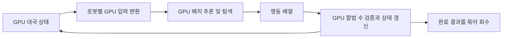

# GPU 배치 입출력 규격 후보

상태: 설계 제안, 미구현. 작성 기준: 2026-10-14.

기본 작업량은 1,000대국 이상이며, 게임 상태 갱신과 로봇 추론을 모두 GPU에서 처리하는 것이 목표입니다. 외부 구현 조사 내용은 [저장소별 호환성 검토](repository-compatibility.md)에 정리했습니다.

## 1. 권장 방향

**필드별 연속 배열로 이루어진 공통 배치 스키마를 정의하고, 같은 프로세스의 GPU 텐서 전달을 주 경로로 사용합니다.** 프레임워크가 다르면 DLPack으로 배열을 교환하는 후보를 권장합니다. 별도 프로그램을 연결할 때는 같은 논리 스키마를 이진 배치로 전달하는 호환 경로를 둡니다.

설정·기능 협상은 JSON으로 처리하고, 매 턴의 상태와 행동은 숫자 배열로 처리합니다. 결과와 기보는 묶어서 회수합니다.

NVIDIA는 데이터의 GPU 상주, CPU↔GPU 전송 축소, 작은 전송의 배치화를 권장합니다. 이 문서의 구조는 그 원칙을 이 프로젝트에 적용한 설계 제안이며 실제 속도는 측정해야 합니다. [CUDA Best Practices: Data Transfer](https://docs.nvidia.com/cuda/cuda-c-best-practices-guide/index.html#data-transfer-between-host-and-device)

## 2. 전달 방식 후보

| 후보 | 적용 조건 | 이점 | 비용과 제약 | 권장 용도 |
|---|---|---|---|---|
| GPU Tensor / DLPack | 동일 프로세스, 호환되는 GPU 배열 라이브러리 | 상태→추론→행동→상태 갱신을 GPU에서 연결 가능 | 버퍼 수명, 스트림 동기화, dtype·layout 변환 관리 필요 | 주 실행 경로 |
| 연속 이진 배열 / CPU 공유메모리 | 다른 언어 또는 별도 프로세스 | JSON 배열 파싱을 피하고 일괄 전달 가능 | CPU 실행 로봇과 연결하면 CPU↔GPU 이동 필요 | 기존 로봇 호환 경로 |
| JSON 배치 | 초기 연동, 수동 검사 | 구현과 내용 확인이 쉬움 | 숫자 배열 변환과 반복 직렬화 비용 | 설정, 디버깅, 작은 검증 대국 |
| GPU IPC | 별도 프로세스에서 장치 메모리 공유 필요 | GPU 데이터의 프로세스 간 공유 가능성 | OS·API 지원, 이벤트, 장애 시 회수까지 검증 필요 | 후속 확장 후보 |

DLPack은 배열 메모리 교환 계약입니다. 네트워크 메시지 규격이나 기존 CPU 게임·탐색을 GPU로 옮기는 기능이 아닙니다. 가능한 경우 데이터를 공유하지만 dtype·배치 재배열·기기 변환이 필요하면 복사가 생길 수 있습니다. 생산자와 소비자의 스트림 및 메모리 수명을 함께 관리해야 합니다. [DLPack Python Specification](https://dmlc.github.io/dlpack/latest/python_spec.html)

GPU IPC는 기본 요구사항으로 두지 않습니다. NVIDIA의 Programming Guide와 Driver API에는 Windows 지원에 관한 설명 차이가 있으므로 실제 사용할 API·드라이버·OS 조합에서 검증해야 합니다. [CUDA IPC Guide](https://docs.nvidia.com/cuda/cuda-programming-guide/04-special-topics/inter-process-communication.html), [CUDA Driver API](https://docs.nvidia.com/cuda/cuda-driver-api/cuda_driver_api/group__CUDA__MEM.html)

## 3. 공통 스키마 후보

첫 프로파일은 조사 대상과 맞춰 **9×9 보드, 착수 81개와 패스 1개**를 제안합니다. 게임 규칙은 아직 확정하지 않으며 `ruleset_id`와 규칙 버전으로 별도 식별합니다.

### 세션 설정

대국 시작 시 한 번 전달합니다.

| 항목 | 의미 |
|---|---|
| `schema_version`, `ruleset_id`, `ruleset_version` | 입출력 계약과 적용 게임 규칙 |
| `board_shape`, `action_count` | 첫 후보는 `[9,9]`, `82` |
| `coordinate_system`, `cell_encoding` | 0기반 행·열, 절대 선공·후공 관점과 칸 코드 |
| `robot_id`, `source_revision`, `model_id` | 코드·가중치·모델 구조를 포함한 참가 결과물 식별 |
| `adapter_kind`, `execution_backend` | 행동 선택 로봇 / 정책 모델 / 서버 연동, GPU 또는 CPU 실행 범위 |
| `native_observation`, `native_output` | 채널 순서, dtype, 축, 정책·가치 의미 등 원래 계약 |
| `search_owner`, `decision_rule`, `execution_budget` | 탐색 주체, 행동 선택 방식, 국면별 예산 |
| `transport`, `device`, `batch_capacity` | 전달 방식, GPU 번호, 동시 처리 상한 |
| `seed_policy`, `termination_policy` | 경기별 난수, 기권·무효 수·시간초과·수 제한 처리 |

재고 제한, 자충수, 집 소유권 유지, 덤과 동점 판정, 중앙 중립 칸 등은 규칙 명세에 포함합니다. 각 구현의 enum 숫자나 규칙 기본값을 그대로 공통 계약으로 취급하지 않습니다.

### 인터페이스 → 로봇: `ObservationBatch`

`B`는 이번 호출의 배치 크기입니다. 고정 크기 버퍼를 쓰면 실제 참가 행은 `valid`로 구분합니다. 동일 배치에는 같은 규칙·입력 계약을 적용합니다.

| 필드 | 형태와 타입 후보 | 의미 |
|---|---|---|
| `request_id` | 세션 내 고유 `int64`, 호출당 1개 | 요청·응답 연결 |
| `game_id` | `int64[B]` | 재배열·슬롯 재사용과 무관한 경기 ID |
| `state_revision` | `int32[B]` | 수락된 착수·패스마다 증가하는 상태 버전 |
| `valid` | `bool[B]` | 이번 로봇이 행동해야 하는 진행 중 경기만 참 |
| `board` | `uint8[B,9,9]` | `0=빈칸, 1=선공, 2=후공, 3=중립` |
| `ownership` | `uint8[B,9,9]` | `0=미소유, 1=선공 집, 2=후공 집` |
| `to_play` | `uint8[B]` | `1=선공, 2=후공` |
| `stones_left` | `int32[B,2]` | 선공·후공 순서의 남은 돌; 미사용 규칙이면 기능 협상에서 제외 |
| `consecutive_passes` | `uint8[B]` | 누적 패스와 구별되는 연속 패스 횟수 |
| `legal_mask` | `bool[B,82]` | 현재 공통 규칙에서 허용하는 행동 |

GPU 논리 bool은 이진 전달 시 0/1의 1바이트 값으로 정의합니다. 각 필드의 축과 연속성을 고정하고, 이진 경로는 little-endian, 고정 너비, 배열 offset·길이를 명시합니다. C++ struct 자체를 wire format으로 보내지 않습니다. `request_id` 같은 제어 정보는 CPU에 있어도 되며, 실제 상태·마스크·행동 배열은 주 경로에서 GPU에 유지합니다.

`board[B,9,9]`가 모든 커널에서 가장 빠른 메모리 배치라는 뜻은 아닙니다. 내부 규칙 커널의 레이아웃은 접근 패턴에 맞춰 선택하고 외부 계약과의 변환을 GPU에서 처리합니다.

보드만 전달해서는 집 소유권 이력과 패스 상태를 복원할 수 없습니다. 종료 경기는 로봇 입력의 유효 행에서 제외하고 엔진 내부에서는 승자·사유 등 종료 상태를 보존합니다. 완전한 체크포인트나 상태 내보내기에는 규칙 설정과 종료 결과도 포함합니다. [Alpha-Yoo State](https://github.com/yumin0544/Alpha-Yoo-for-Great-Kingdom/blob/0c6150e32293e437df6bf11fd4dcbc4c02f321f2/engine/include/board/State.h#L46-L76)

### 로봇 → 인터페이스: `ActionBatch`

필수 출력은 선택 행동과 상태입니다. 신경망 확률 분포를 출력하는 로봇으로 참가 범위를 제한하지 않습니다.

| 필드 | 형태와 타입 후보 | 의미 |
|---|---|---|
| `request_id` | 입력과 동일 | 요청별 응답 결합 |
| `action_id` | `int32[B]` | `0..80=row*9+col`, `81=패스` |
| `status` | `uint8[B]` | 후보 코드: `0=행동, 1=기권, 2=실행 오류` |
| `policy` | 선택 `float32[B,82]` | 마스킹 후 확률; 필요할 때만 제공 |
| `value` | 선택 `float32[B]` | 의미가 확인된 경우에만 현재 차례의 승패 평가 `[-1,1]` |
| `search_stats` | 선택 고정 배열 | 탐색 횟수·방문 수 등 |

출력 행 순서는 요청과 같아야 합니다. 엔진은 요청 시점의 `game_id`와 상태 버전 매핑을 보존하고, 적용 시에도 일치하는지 확인합니다. 재배열 응답을 지원하려면 별도 프로파일에서 ID를 응답에 명시합니다.

`valid=false`인 행과 `status!=0`인 행의 행동값은 무시합니다. 기권은 82차원 정책에 새 행동을 추가하지 않고 별도 상태로 표현합니다. 범위를 벗어난 정수, 실수·불리언 좌표, 비유한 정책값은 오류로 처리하며, `int64` 출력을 `int32`로 바꾸기 전에 행동 범위를 검사합니다.

### 기존 출력의 정규화

| 원래 출력 | 어댑터의 역할 |
|---|---|
| 행동 인덱스 | 범위와 패스 코드 확인 후 `action_id`로 연결 |
| `(x,y)` / `(row,col)` | 축 순서·0/1기반·상하 방향을 명시적으로 변환 |
| 좌표 문자열 / `PASS` | 구현별 파서로 변환; 예: Discord의 `A9→0`, `A1→72`, `E5→40` |
| logits / log-probabilities | 출력 종류를 선언하고 합법 마스크를 적용해 선택 |
| probabilities / visit counts | 음수·비유한 값 등을 검사하고 합법 행동만 정규화·선택 |
| 전체 상태 스냅숏 | 상태 가져오기/서버 연동으로 처리; 곧바로 선택 행동으로 간주하지 않음 |

정책만 있는 모델에 탐색기를 붙이거나 기존 MCTS를 대체하면 참가 결과물의 행동도 달라집니다. `search_owner`, 탐색 예산, 선택 방식을 참가자 정보에 기록하고 전체 로봇 평가와 정책 모델 평가를 구분합니다. 값의 관점이 불명확한 모델은 `value`를 임의로 부호 변환하지 않습니다.

## 4. GPU 배치 실행

- 같은 로봇의 차례인 경기들을 모아 배치 처리합니다. 한 대국 안에서는 선택→검증→갱신의 순서를 유지합니다.
- 완료·패딩 행의 마스크는 전부 거짓으로 두고 추론·선택에서 제외합니다. 종료 후 빈 슬롯에 새 경기를 넣을 때 새 `game_id`를 부여하고 로봇의 경기별 캐시·탐색 트리도 초기화합니다.
- 종료 경기를 압축하거나 새 경기로 채우는 작업과 모델용 특징 변환도 GPU에서 수행하는 방향을 우선합니다. 매 턴 전체 상태를 `.cpu()`·`.numpy()`·JSON으로 변환하는 경로는 피합니다.
- 사전 할당 버퍼를 재사용하되 생산 완료, 소비 완료, 버퍼 재사용 사이의 이벤트 의존성을 정의합니다. DLPack으로 공유한 입력을 로봇이 수정하지 않는 계약을 두며 필요하면 GPU 입력 스테이징을 사용합니다.
- CPU 게임 엔진이나 탐색기는 포맷 변환만으로 GPU에서 실행되지 않습니다. 기존 로봇 호환 모드와 완전 GPU 모드의 처리 범위를 명시합니다.

CPU 호환 경로의 복사는 작은 필드별 전송 대신 배치 버퍼로 묶고, pinned memory와 비동기 복사 적용은 실제 장치의 overlap 지원을 확인해 결정합니다. [CUDA Best Practices: Asynchronous Transfers](https://docs.nvidia.com/cuda/cuda-c-best-practices-guide/index.html#asynchronous-and-overlapping-transfers-with-computation)

## 5. 메모리 표현 후보

| 표현 | 장점 | 검토할 비용 |
|---|---|---|
| `uint8` 보드·소유권 + bool 마스크 | 범용 어댑터 작성이 쉽고 크기가 작음 | 내부 int32 커널 또는 모델 특징으로 변환 필요 |
| `int32` 상태 배열 | 기존 Alpha-Yoo GPU 상태와 연결하기 쉬움 | 더 큰 상태 크기, 특정 native layout 결합 방지 필요 |
| 비트 패킹 / bitboard | 상태·마스크 저장량을 줄일 수 있음 | unpack·특징 변환·집 탐색 비용, 구현 복잡도 |

첫 후보는 공통 경계에서 작은 정수 배열을 사용하고 필요한 변환을 GPU에서 수행하는 것입니다. 비트 패킹은 실제 병목 측정 후 선택합니다.

9×9의 `B=1000`일 때 보드·소유권·마스크만 합하면 `1000×(81+81+82)=244,000`바이트입니다. 위 입력의 행별 필수 필드를 전부 포함하고 bool을 1바이트로 계산하면 약 267,000바이트입니다. 선택 필드, 정렬 padding, 엔진 내부 상태, 모델·활성값·탐색 트리 메모리는 별도입니다. 작은 입출력 크기가 곧 1,000대국 동시 탐색 가능성을 보장하지는 않습니다.

## 6. 결과와 비교 조건

완료 대국 결과는 `game_id`, 참가자와 선후 배치, `ruleset_id`, 승자, 종료 사유, 점수, 수 수, seed, 예산, 실행 오류를 포함하는 별도 배치로 회수합니다. 기보는 요청할 때 저장하는 방향을 제안합니다.

비교에서는 동일 규칙, 선후 교대, 국면별 예산, 경기별 독립 난수를 명시합니다. 시간 예산과 탐색 횟수 예산은 서로 다른 비교 조건입니다. GPU 함수 반환 시각은 계산 완료 시각과 다를 수 있으므로 시간 측정 경계를 완료 이벤트로 정의합니다. 오류·시간초과·수 제한은 정상 완료와 구별해 보고합니다.

후보 채택 전에는 다음을 측정합니다.

- 배치 크기별 완료 대국/초, 국면/초, GPU 메모리와 전송량.
- 입력 변환, 로봇 추론·탐색, 규칙 갱신, 결과 회수 각각의 시간.
- CPU 참조 구현과 GPU 규칙의 합법 수·종료·점수 일치.
- 좌표·패스·정책 의미 변환, 지연 응답, 슬롯 재사용 시의 경기 연결 정확성.

현재 문서는 후보 제안이며 성능 측정이나 호환 실행을 완료했다는 의미는 아닙니다.
